# Özel Binekler

Bu sayfada yetenekli binekler tek tek anlatılıyor: binene verdikleri bonuslar ve `.binekbonus` yetenekleri. Sayfanın sonunda yeteneği olmayan sıradan bineklerin listesi var.


Bir bineğin statlarını, ölünce kaç Binek Resurrection Scroll ile dirildiğini ve vuruş özelliğini `.bb` menüsünden görebilirsiniz (**Binekler: Genel Bilgiler** sayfası).


## Özet

### `.binekbonus` yeteneği olan binekler

| Binek           | Yetenek                                    | Bekleme  |
| --------------- | ------------------------------------------ | -------- |
| Simurg          | Savaş Borusu                               | 5 dk     |
| Huma            | Koruyucu Aura                              | 5 dk     |
| Nemea           | Parçalayan Pençe (+ Avcı İçgüdüsü)         | 5 dk     |
| Lamassu         | Mana Yakma                                 | 5 dk     |
| Bloodwing       | Fireball (+ ölümcül darbe koruması)        | 1 dk     |
| Armored Steed   | Armor Ignore (+ PvP koruması)              | 5 dk     |
| Grayer          | Kan Kokusu (+ attan düşmez, poison tutmaz) | 5 dk     |
| Gryphon         | In Nox                                     | 5 dk     |
| Hipogrif        | In Nox (+ alan büyüsü siler)               | 5 dk     |
| Pixiu           | Lamb Time (körlük)                         | 5 dk     |
| T-Rash          | Gate siler (+ Parablow/Stun daha sık)      | 5 dk     |
| Mysterious Horn | Mysterious Shield (dokunulmazlık)          | \~7,5 dk |
| Fiura           | Klon + görünmezlik                         | \~7,5 dk |
| Ferrin          | Absorb the Energy + `.ferrinheal`          | 7,5 dk   |
| Percheron       | Percheron Healing (+ büyü bağışıklığı)     | 5 dk     |
| Ordeal          | In Flam Power                              | 5 dk     |
| Typhaon         | Vas An Ort                                 | 3 dk     |

### Kendi komutu olan binekler

| Binek        | Komut         | Bekleme |
| ------------ | ------------- | ------- |
| Fire Steed   | `.steedfire`  | 2 dk    |
| Silver Steed | `.steedlight` | 2 dk    |
| Unicorn      | `.unires`     | 5 dk    |
| Silvercorn   | `.cornres`    | 5 dk    |

### Sadece binince bonus veren binekler

| Binek                         | Bonus                                                          |
| ----------------------------- | -------------------------------------------------------------- |
| Manticore                     | Sadece pure mage biner; oyunculara teleport, mana/can yenileme |
| Nightmare                     | Canınız azalınca otomatik can basar                            |
| Numa                          | 4 büyüye bağışıklık                                            |
| Indra                         | Hits Talisman ve Mana Sandals daha güçlü                       |
| Primal Raptor                 | Teleport engeli                                                |
| Orn                           | Teleport engeli                                                |
| Arctic Bear                   | Fireball büyünüz güçlenir                                      |
| Glacier Steed                 | Paralyze Field ve ağdan etkilenmez                             |
| Beetle Wert                   | Düzenli olarak ağ bırakır                                      |
| Arcane Ostard / Horse / Llama | Warrior'ı zehirden korur                                       |
| Evil Wolf / Evil Horse        | Vurduğunuz hasardan can çalar                                  |

Ghost Ostard için **Binek Taşı ve Yumurtalar** sayfasına bakın.

## Ortak kurallar

* `.binekbonus` her zaman **bindiğiniz** bineğin yeteneğini kullanır.
* Yeteneklerin çoğu canınız **50'nin altındayken** ve **safe alanda** kullanılamaz.
* Hedefli yetenekler sadece **oyunculara** atılabilir, kendinize atılamaz. Hedef görüş alanınızda olmalıdır.
* **Binek bonusu koruması:** In Nox (Gryphon, Hipogrif), Ordeal, Fire Steed, Silver Steed ve Bloodwing ateş topları, Mana Yakma ve Parçalayan Pençe'den etkilenen oyuncu **2 dakika** boyunca bu binek yeteneklerinden tekrar etkilenmez. Hedefe "Bir binek bonusuna maruz kaldınız!" yazar.
* **Teleport engeli:** Şu bineklere binen oyuncunun üstüne Teleport büyüsüyle ışınlanılamaz: Armored Steed, Gryphon, Hipogrif, Pixiu, Mysterious Horn, Fiura, Ferrin, Primal Raptor, Percheron, Ordeal, Orn.

### Bineklerin kendini iyileştirmesi

Birçok binek (Bloodwing, Armored Steed, Grayer, Gryphon, Hipogrif, Pixiu, T-Rash, Mysterious Horn, Fiura, Ferrin, Percheron, Ordeal, Fire Steed, Silver Steed, Silvercorn, Numa, Indra, Evil Wolf, Evil Horse) savaşırken canı çok azalınca kendini bir miktar iyileştirir ve üzerindeki zehri temizler. Bu, bir bineğin ömrü boyunca **en fazla 3 kez** olur (figüre çevirmek hakkı sıfırlamaz).

Grayer ve Percheron vuruş yediklerinde zehri her zaman temizler, bu 3 hakkı harcamaz.

***

## Simurg

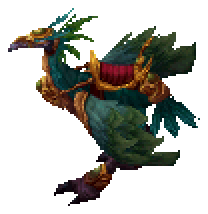

* **Komut:** `.binekbonus` ya da `.savasborusu`

**Savaş Borusu** (5 dakikada bir): Siz ve **6 kare** içindeki **aynı guild üyeleri** **10 saniye** boyunca daha fazla silah hasarı verir. Üst üste binmez. Guildiniz yoksa sadece siz alırsınız.

## Huma

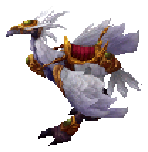

* **Komut:** `.binekbonus` ya da `.koruyucuaura`

Simurg'un beyaz hali. **Koruyucu Aura** (5 dakikada bir): Siz ve **6 kare** içindeki **aynı guild üyeleri** **8 saniye** boyunca oyuncuların silah vuruşlarına karşı ek koruma alır. Üst üste binmez. Canavar vuruşlarını etkilemez.

## Nemea

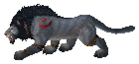

* **Komut:** `.binekbonus` ya da `.parcalayanpence`

**Parçalayan Pençe** (5 dakikada bir): **3 kare** içindeki bir oyuncuya hasar verir ve hedefin kalkanı **10 saniye** boyunca **Parry Blow yapamaz**. Hedef 2 dakika binek bonusu korumasına girer.

**Avcı İçgüdüsü** (binince, sürekli): Canı çok azalmış oyunculara daha fazla silah hasarı verirsiniz. Savaş Borusu ile birlikte çalışır.

## Lamassu

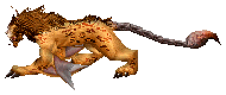

* **Nereden:** Random Egg (nadir çıkar)
* **Komut:** `.binekbonus` ya da `.manayakma`

Kanatlı aslan. **Mana Yakma** (5 dakikada bir): **10 kare** içindeki bir oyuncunun manasını yakar; hedef, yakılan manaya göre hasar da alır. Mage ve warlock'lara karşı etkilidir. Hedefin hiç manası yoksa yetenek kullanılmaz ve bekleme başlamaz. Hedef 2 dakika binek bonusu korumasına girer.

## Bloodwing

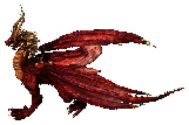

* **Komut:** `.binekbonus` ya da `.bloodwing`; kalan süre için `.bwsure`

**Ölümcül darbe koruması** (binince, 15 dakikada bir): Canınız çok azken ya da gelen darbe sizi öldürecekken Bloodwing o darbeyi engeller ve sizi hayatta tutar. Canınız çok azken gelen büyüleri de aynı şekilde engeller. Koruma kullanıldıktan sonra **15 dakika** bekler. `.bwsure` kalan süreyi gösterir.

**Fireball** (`.binekbonus`, 1 dakikada bir): **11 kare** içindeki bir hedefe ateş topu atar. Hedef 5 dakika tekrar Bloodwing ateş topu yiyemez ve 2 dakika binek bonusu korumasına girer.

## Armored Steed

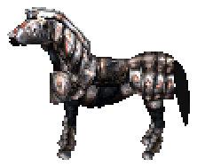

* **Nereden:** Storm Puzzle koleksiyon ödülü (**Solo Dungeon ve Puzzle Koleksiyonları** sayfası)
* **Komut:** `.binekbonus` ya da `.ignore`

**Binince:** Ek armor ve oyuncuların silah vuruşlarına karşı armorunuza bağlı **PvP hasar indirimi** kazanırsınız. Set indiriminizle binek indiriminden hangisi yüksekse o uygulanır.

**Armor Ignore** (`.binekbonus`, 5 dakikada bir): **10 kare** içindeki bir oyuncuya atılır. Hedef **60 saniye** boyunca oyunculardan aldığı fiziksel vuruşlarda ek hasar alır.

## Grayer

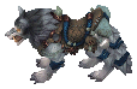

* **Komut:** `.binekbonus` ya da `.kankokusu`

**Binince:**

* **Attan düşmezsiniz:** Dismount bonusu, ok bonusu, Earth Bow ve binek vuruşları sizi bineğinizden düşüremez.
* **Poison tutmaz:** Poison büyüsü ve Poison Field size işlemez, üstünüzdeki zehir temizlenir.
* **Bleeding bonusu daha sık** çıkar.

**Kan Kokusu** (5 dakikada bir): **10 kare** içindeki oyuncuların kokusunu alır. Gizlenmiş (hiding), invisibility, Ma'at ve Fiura görünmezliğindeki oyuncular açığa çıkar ve **15 saniye** boyunca tekrar gizlenemez. Aynı guild üyeleri, safe alandakiler ve ölüler etkilenmez. Etki alanında kimse yoksa 5 dakikalık bekleme başlamaz (10 saniye bekler). Hasar vermez, binek bonusu korumasına bakmaz.

**Grayer'in kendisi** Poison büyüsünden etkilenmez.

## Gryphon

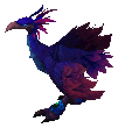

* **Komut:** `.binekbonus` ya da `.griffon`

**In Nox** (5 dakikada bir): **10 kare** içindeki bir oyuncuya Poison büyüsü atar. Hipogrif'e binmiş oyuncuya atılamaz. Hedef 2 dakika binek bonusu korumasına girer.

**Binince:** Teleport engeli.

## Hipogrif

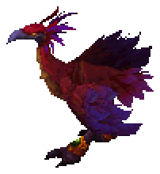

* **Komut:** `.binekbonus` ya da `.hipo`

**In Nox** (5 dakikada bir): Gryphon ile aynı, **10 kare** içindeki bir oyuncuya Poison büyüsü.

**Binince:**

* Gryphon'un In Nox'undan etkilenmezsiniz.
* **Alan büyüsü siler:** Hemen yanınızdaki (1 kare) Wall of Stone, Energy Field, Paralyze Field, Poison Field ve Fire Field'ları **2 saniyede bir** kaldırır ("Duvardan Etkilenmez").
* Teleport engeli.

## Pixiu

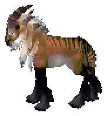

* **Komut:** `.binekbonus` ya da `.lamb`

**Lamb Time** (5 dakikada bir): **5 kare** içindeki bütün oyuncuların (guild üyeleriniz dahil) ekranı **3 saniye** kararır ve hepsi biraz hasar alır.

**Binince:** Teleport engeli.

## T-Rash

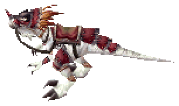

* **Komut:** `.binekbonus` ya da `.raptorgate`

**Gate Dispeler** (5 dakikada bir): Runebook ile açılmış bir gate'i hedefleyip siler.

**Binince:** Parablow ve Stun bonuslarınız daha sık çıkar.

## Mysterious Horn

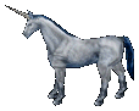

* **Komut:** `.binekbonus` ya da `.horn`

**Mysterious Shield** (yaklaşık 7,5 dakikada bir): **4 saniye** boyunca dokunulmaz olursunuz.

**Binince:** Teleport engeli.

## Fiura

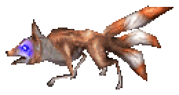

* **Komut:** `.binekbonus` ya da `.fiura`

**Klon** (yaklaşık 7,5 dakikada bir): Yerinizde sizin görünüşünüzde, aynı kıyafetli bir **klon** belirir (7 saniye). Siz **5 saniye görünmez** ve **hızlı** olursunuz.

**Binince:** Teleport engeli.

## Ferrin

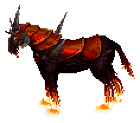

* **Nereden:** Binek Taşı, **60.000.000 gold**
* **Komut:** `.binekbonus` ya da `.ferrin`; `.ferrinheal`

**Absorb the Energy** (`.binekbonus`, 7,5 dakikada bir): **5 kare** içindeki bir oyuncunun enerjisini çeker: hedef kısa süre yavaşlar ve hasar alır. Aynı oyuncu 2 dakika tekrar Ferrin bonusu yiyemez.

**Ferrin Healing** (`.ferrinheal`, 7,5 dakikada bir): Seçtiğiniz oyuncuya (kendiniz dahil) can basar.

**Binince:** Teleport engeli.

## Percheron

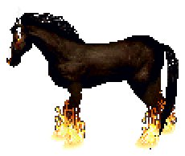

* **Nereden:** **Ruh Belgesi** ile ruh toplayarak. Belge Genel Satıcı'dan **50.000 gold**. Ayrıntılar **Binek Taşı ve Yumurtalar** sayfasında.
* **Gereken ruhlar:** 2 Evil Wolf, 1 Raptor, 15 Tartarus, 18 Silvercorn, 7 Numa, 5 Manticore, 20 Mustang, 15 Beetle Wert, 2 Chimaira, 15 Wendigo, 3 Arctic Bear, 2 Typhaon, 5 Orn, 20 Mid Ostard
* **Komut:** `.binekbonus` ya da `.percheron`

**Binince:**

* **Flamestrike, Energy Bolt ve Mind Blast** büyüleri size işlemez ("sahibini korur").
* Teleport engeli.

**Percheron Healing** (5 dakikada bir): Can basar, üzerinizdeki zehri ve kanamayı temizler. Canınız tamken kullanılamaz.

**Percheron'un kendisi** Poison büyüsünden etkilenmez, vuruş yediğinde zehri hep temizler.

## Ordeal

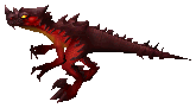

* **Nereden:** Ordeal Puzzle koleksiyon ödülü (**Solo Dungeon ve Puzzle Koleksiyonları** sayfası)
* **Komut:** `.binekbonus` ya da `.ordeal`

**In Flam Power** (5 dakikada bir): **10 kare** içindeki bir oyuncuya Energy Bolt etkisi verir ve etrafında birkaç saniyelik bir **ateş çemberi** oluşturur. Hedef 2 dakika binek bonusu korumasına girer.

**Binince:** Teleport engeli.

## Typhaon

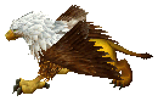

* **Nereden:** Random Egg
* **Komut:** `.binekbonus` ya da `.typhaon`

**Vas An Ort** (3 dakikada bir): Mass Dispel büyüsünü beklemeden ve mana harcamadan atar.

## Fire Steed

* **Nereden:** Random spawn, Random Egg, Animal Book
* **Komut:** `.steedfire`

**Fireball** (2 dakikada bir): **11 kare** içindeki bir hedefe ateş topu atar. Hedef 2 dakika binek bonusu korumasına girer.

## Silver Steed

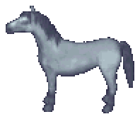

* **Nereden:** Random spawn, Random Egg, Animal Book
* **Komut:** `.steedlight`

**Steedlight** (2 dakikada bir): **11 kare** içindeki bir oyuncuya Fireball büyüsü atar. Hedef 2 dakika binek bonusu korumasına girer.

## Unicorn

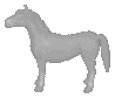

* **Nereden:** Binek Taşı **15.000.000 gold**, random spawn
* **Komut:** `.unires`

**Unicorn Res** (5 dakikada bir): Ölüyken (hayaletken) `.unires` yazıp **kendi Unicorn'unuzu** seçerseniz sizi diriltir. Evlerin içinde kullanılamaz.

## Silvercorn

* **Nereden:** Random spawn, Random Egg, Animal Book
* **Komut:** `.cornres`

**Silvercorn Res** (5 dakikada bir): Unicorn ile aynı; ölüyken `.cornres` yazıp **kendi Silvercorn'unuzu** seçerseniz sizi diriltir. Evlerin içinde kullanılamaz.

## Manticore

* **Nereden:** Random Egg

**Sadece pure mage binebilir:** Magery, Meditation ve Evaluating Intelligence 99.1 üstü; Fencing, Swordsmanship, Macefighting, Tactics ve Wrestling 20 altı.

**Binince:**

* **Oyunculara teleport:** Teleport büyüsüyle oyuncuların üstüne ışınlanabilirsiniz (Manticore olmadan oyunculara teleport olunamaz). Her ışınlanmadan sonra **16 saniye**, elinizde Tessen de varsa **10 saniye** beklenir.
* Mana ve canınız düzenli olarak yenilenir (zehirliyken can dolmaz).

## Nightmare

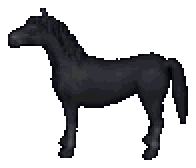

* **Nereden:** Mother Ostard Egg

**Nightmare Heal** (binince, otomatik): Vuruş yiyip canınız azalınca otomatik can basar. **5 dakikada bir** çalışır; zehirliyken çalışmaz (zehir geçince dener). `.nightheal` özelliği hatırlatır.

## Numa

* **Nereden:** Random Egg, Soul Egg

**Binince:** **Energy Bolt, Flamestrike, Earthquake ve Chain Lightning** büyüleri size işlemez ("Resistation").

## Indra

* **Nereden:** Soul Egg

**Binince:** **Hits Talisman** ve **Mana Sandals** daha fazla can ve mana basar.

## Primal Raptor

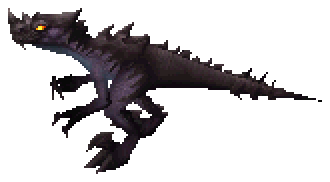

* **Nereden:** Binek Taşı, **50.000.000 gold**

**Binince:** Teleport engeli. `.binekbonus` yeteneği yoktur.

## Orn

* **Nereden:** Random Egg

**Binince:** Teleport engeli.

## Arctic Bear

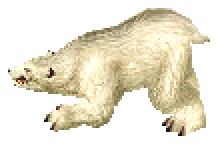

Artık dağıtılmayan eski bir etkinlik bineğidir.

**Binince:** Fireball büyünüz daha fazla hasar verir. Bu güçlendirilmiş atış **60 saniyede bir** olur, aynı hedef de 60 saniye boyunca tekrar güçlendirilmiş ateş topu yemez.

Vurduğu oyuncuyu zaman zaman bineğinden düşürür.

## Glacier Steed

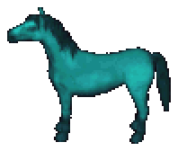

* **Nereden:** Balık etkinliği ödül menüsü, **500.000 Rampage Balığı**

**Binince:** Paralyze Field size işlemez, örümcek ağlarına (web) takılmazsınız.

## Beetle Wert

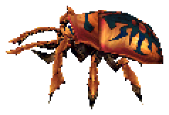

* **Nereden:** Random Egg

**Binince:** **45 saniyede bir** altınıza 2-3 saniyelik bir **ağ** bırakır (safe alanda bırakmaz). Ağa basan oyuncular takılır; Beetle ve Glacier Steed binicileri takılmaz.

## Arcane Ostard, Arcane Horse, Arcane Llama

* **Nereden:** Arcane Ostard: Binek Taşı **5.000.000 gold**. Üçü de: Random Egg, Olgun Ostard Egg

**Binince (sadece warrior'lar):** Magery 20 ve altı, Meditation 8 altı, Evaluating Intelligence 15 altı, Parrying ve Tactics 98 üstü olan oyuncuyu Poison büyüsü ve Poison Field'dan belli bir ihtimalle korur.

## Evil Wolf ve Evil Horse

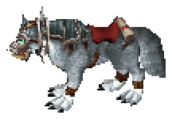 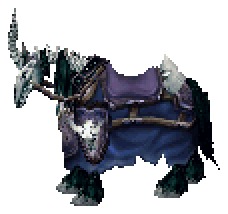

* **Nereden:** Özel görev hazinesinin bekçisi öldürülünce çıkar, evcilleştirilir (**Taming (Evcilleştirme)** sayfası).

**Binince:** Canınız tam değilken silahla vurduğunuz her vuruşta, verdiğiniz hasarın bir kısmı kadar **can** kazanırsınız.

***

## Sıradan binekler

Bu bineklerin binene verdiği bir bonus ya da `.binekbonus` yeteneği yoktur.

| Binek           | Nereden                                           |
| --------------- | ------------------------------------------------- |
| Raptor          | Binek Taşı 30M, random spawn                      |
| Cu Sidhe (Wolf) | Binek Taşı 500K, yumurtalar, hazine               |
| Kii Rin         | Binek Taşı 1M, yumurtalar, hazine                 |
| N-Mandre        | Binek Taşı 800K, random spawn, Random Egg, hazine |
| Tartarus        | Random Egg                                        |
| Chimaira        | Random Egg                                        |
| Wendigo         | Random Egg                                        |
| Frenzied Ostard | Random Egg, Special Egg                           |
| Mid Ostard      | Random Egg, Special Egg, Animal Book              |
| Shire           | Random Egg, Olgun Ostard Egg, Animal Book, hazine |
| Mustang         | Random Egg, Animal Book, hazine                   |
